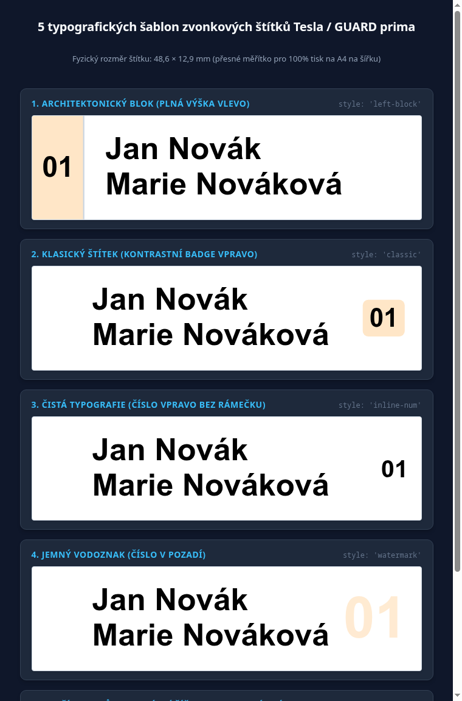
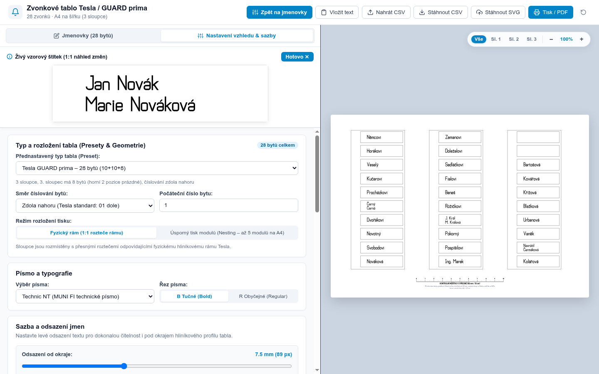

# Zvonkové tablo Tesla / GUARD prima (28 bytů)

Interaktivní webový editor a generátor tiskových podkladů pro jmenovky zvonkového tabla bytového domu.

Aplikace je navržena pro zvonkové tablo **Tesla / GUARD prima** s 28 byty (3 sloupce: 10 + 10 + 8 zvonků) a umožňuje snadnou editaci jmenovek, import/export CSV, vizuální kontrolu v reálném čase a tisk na formát **A4 na šířku v přesném fyzickém měřítku 1:1**.

---

## 🚀 Rychlý start (pro běžné použití)

Pro běžné použití **není potřeba nic instalovat ani spouštět žádný server**. 

Stačí otevřít soubor [`zvonky-editor.html`](zvonky-editor.html) v libovolném moderním webovém prohlížeči (Chrome, Firefox, Safari, Edge). Soubor je 100% samostatný (self-contained), funguje zcela offline bez připojení k internetu a obsahuje veškerá potřebná písma i grafické podklady přímo v sobě.

---

## ✨ Klíčové funkce

- **100% samostatná offline aplikace ([`zvonky-editor.html`](zvonky-editor.html))**: Žádné externí závislosti, žádné CDN – všechna písma a skripty jsou vloženy přímo do jednoho HTML souboru.
- **Čistá vektorová grafika**: Původní rastrový podklad byl kompletně nahrazen přesnými vektorovými prvky (`<rect>`). Ořezové linky i rámečky jsou dokonale ostré na jakékoliv tiskárně.
- **Písma přímo v balíčku s plnou českou diakritikou**:
  - **Technic NT** (z písmolijny FI MUNI) – technické normalizované písmo vycházející z ČSN, výchozí volba pro čistý industriální vzhled tabla.
  - **DIN 1451 / Bahnschrift** (`DINish`) – klasický standard pro informační systémy a značení.
  - **Fira Sans Condensed** – moderní úzký humanistický sans-serif.
  - **Iosevka** – úzký monospace font se strojovým vzhledem.
  - **Futura** – geometrický bezpatkový font.
- **Přepínač řezu písma (`B`)**: Okamžité přepnutí mezi základním (Regular) a tučným (Bold) řezem.
- **Podpora dvouřádkových jmenovek**: Pokud štítek obsahuje více jmen, stačí je oddělit lomítkem nebo středníkem (např. `Jan Novák / Marie Nováková`). Text se automaticky zalomí a vystředí do dvou řádků.
- **Chytré přizpůsobení délky textu**: Aplikace dynamicky měří šířku jména. Při delším textu automaticky zmenšuje velikost písma a v editačním formuláři zobrazuje varovné štítky:
  - `⚠️ Zmenšeno` (oranžová): text musel být zmenšen, aby se vešel.
  - `⚠️ Nevejde se` (červená): text je příliš dlouhý i při minimální čitelné velikosti písma.
- **5 typografických šablon čísel bytů**:
  - **Architektonický blok (vlevo)** (`left-block`): Blok přes celou výšku slotu ($152{,}4\text{ px}$) se svislou dělící linkou a velkou č číslicí ($42\text{ px}$). Působí celistvě a sjednoceně s tělem tabla.
  - **Klasický štítek (kontrastní badge vpravo)** (`classic`): Zaoblený obdélníček s číslem bytu přesně vycentrovaný v ose slotu a s bezpečným $23\text{ px}$ odstupem od pravého okraje.
  - **Čistá typografie (číslo vpravo)** (`inline-num`): Moderní číslo bytu ($36\text{ px}$) bez rámečku či podkladu, čistý styl.
  - **Jemný vodoznak (v pozadí)** (`watermark`): Velké ušlechtilé číslo ($84\text{ px}$) v tónu podkladu se zachováním zvolené barvy, neruší čtení jména v popředí.
  - **Bez čísel bytů** (`none`): Maximální šířka pro dlouhá jména a akademické tituly ($554\text{ px}$).

<p align="center">
  
</p>

- **Integrovaný panel Nastavení se živým náhledem**:
  - Přepínač v levém panelu umožňuje plynule přepínat mezi zadáváním jmenovek a detailním nastavením vzhledu, písma a sazby.
  - **Živý vzorový štítek (1:1 náhled)**: Horní karta v nastavení okamžitě vizualizuje libovolnou změnu barvy, fontu či odsazení.
  - Na desktopu zůstává živé celkové tablo na pravé straně **neustále viditelné a interaktivní**.
- **Kompletní záloha a sdílení projektu (YAML soubor)**:
  - Kompletní stav celého tabla (seznam jmen pro všech 28 bytů i veškerá konfigurace písma, barev, šablon a tiskových parametrů) lze jedním kliknutím exportovat do čitelného souboru `tablo-projekt.yaml` s komentáři, nebo zpět načíst.
  - Vhodné pro archivaci verzí v SVJ nebo předávání konfigurace mezi správci.
  - K dispozici je také přímé kopírování/vkládání YAML textu přes schránku.
- **Výběr rozsahu tisku (volba sloupců – úspora toneru / inkoustu)**:
  - Možnost zvolit tisk všech sloupců najednou, nebo **pouze konkrétního sloupce** (např. *Sloupec 2 pro byty 11–20*).
  - Při volbě jednoho sloupce se na formát A4 vytiskne pouze daný sloupec na své přesné fyzické pozici, takže při výměně jmenovek jen v jednom modulu neplýtváte černým ani barevným tonerem.
- **Plná podpora pro mobilní zařízení**:
  - Na telefonech a tabletech ($\le 900\text{ px}$) se 3 sloupce automaticky skládají do 1 přehledného sloupce s velkými dotykovými poli pro pohodlné psaní.
  - Přepínač záložek na mobilu umožňuje rychlý přechod mezi **Jmenovky (28)**, **Nastavení & Sazba** a **Náhled tabla (A4)**.
  - Při přechodu na desktop se automaticky obnoví plnohodnotné rozdělené zobrazení obou panelů vedle sebe.

<p align="center">
  
</p>
- **Vnější ořezové značky (Crop marks)**: Volitelné jemné značky v rozích sloupců mimo tiskovou oblast pro přesné a rychlé řezání pravítkem nebo pákovou řezačkou.
- **Hromadné vložení seznamu (Vložit text)**: Dialog pro zkopírování 28 řádků ze schránky (z Wordu, e-mailu) a okamžité naplnění celého tabla.
- **Klávesová navigace**: Klávesa `Enter` v editačním políčku automaticky posouvá kurzor na další řádek / byt.
- **Plovoucí Zoom & Focus widget**:
  - Krokování lupy (`−` a `+`) v rozsahu 50 % až 400 %.
  - Kliknutí na procenta (`{zoom}%`) **okamžitě obnoví celkový pohled na celou A4**.
  - Tlačítka **`Sloupec 1`**, **`Sloupec 2`**, **`Sloupec 3`** pro okamžité přiblížení na 260 % a automatické vystředění konkrétního sloupce pro detailní kontrolu jmen.
- **Čísla bytů (Flat IDs) pro montáž**: Volitelné podkresové štítky s čísly bytů (`01`–`28`) usnadňující osazování do fyzického tabla. Barva podkladu čísel je nastavitelná přes paletu nebo předvolby (výchozí broskvová `#FFE6C7`, modrá, žlutá, šedá, bílá). Ve výchozím stavu jsou skryté.
- **Tiskové kalibrační pravítko 100 mm**: Umístěno ve spodním okraji stránky pro fyzické ověření pravítkem, že tiskárna nezmenšila ani nezvětšila měřítko.
- **Práce s daty a automatické ukládání**:
  - Drag & Drop CSV souboru přímo do okna prohlížeče.
  - Tlačítka **Nahrát CSV** a **Stáhnout CSV**.
  - Tlačítko **Stáhnout SVG** (vygeneruje samostatné tiskové SVG se všemi vloženými fonty a pevnými rozměry 297 × 210 mm).
  - Průběžné automatické ukládání změn do `localStorage` prohlížeče.

---

## 📐 Rozložení a rozměry tabla

Tablo odpovídá fyzickému uspořádání Tesla / GUARD prima pro 28 bytů (3 svislé sloupce, modul reproduktoru je umístěn vlevo vedle tlačítek):

| Sloupec | Řádky | Byty | Počet štítků |
| :--- | :--- | :--- | :--- |
| **Sloupec 1** (vlevo) | Řádek 0 až 9 | Byty **10** (nahoře) až **01** (dole) | 10 štítků |
| **Sloupec 2** (uprostřed) | Řádek 0 až 9 | Byty **20** (nahoře) až **11** (dole) | 10 štítků |
| **Sloupec 3** (vpravo) | Řádek 2 až 9 | Byty **28** (nahoře) až **21** (dole) | 8 štítků |

- **Rozměr jednoho štítku**: $48{,}6 \times 12{,}9\text{ mm}$ ($490 \times 130\text{ px}$ při 300 DPI).
- **Rozměr jednoho sloupce**: $621 \times 1611\text{ px}$.
- **Výsledný tiskový formát**: A4 na šířku ($297 \times 210\text{ mm}$, $3508 \times 2481\text{ px}$ při 300 DPI).

---

## 🖨️ Pokyny pro bezchybný tisk v měřítku 1:1

Při tisku přímo z prohlížeče (tlačítko **Tisk / PDF** nebo klávesová zkratka `Ctrl+P` / `Cmd+P`) je zásadní správné nastavení v tiskovém okně prohlížeče:

1. **Okraje (Margins)**: Nastavte na **Žádné (None / 0 mm)**!
   > ⚠️ **Pozor na výchozí nastavení prohlížeče:** Pokud v tiskovém dialogu ponecháte volbu *„Výchozí“ (Default)*, prohlížeč automaticky přidá cca 10mm okraje a zmenší celou stránku na cca 90 %. Vytištěné 100mm měřítko by pak mělo jen necelých 9 cm! Nastavením *Žádné* se tiskne v přesném poměru 1:1.
2. **Měřítko (Scale)**: Nastavte na **100 %** nebo **Skutečná velikost** (*Actual size*). Nikdy nepoužívejte volbu *„Přizpůsobit stránce“* (*Fit to printable area*).
3. **Orientace**: Na šířku (*Landscape*).
4. **Formát papíru**: A4.
5. **Grafika na pozadí**: Zaškrtněte **Povolit grafiku na pozadí** (*Background graphics*), aby se vytiskly ořezové rámečky.
6. **Fyzická kontrola**: Po vytištění změřte pravítkem 100mm kalibrační měřítko ve spodní části stránky. Musí měřit přesně 10 cm.

💡 *Alternativa:* Můžete také použít tlačítko **Stáhnout SVG**. Vygenerovaný SVG soubor má fyzické rozměry $297 \times 210\text{ mm}$ pevně zadané přímo v hlavičce a vytiskne se v přesném měřítku 1:1 v libovolném vektorovém programu (Inkscape, Affinity Designer, Illustrator) i v prohlížeči.

---

## 🔧 Fyzická montáž a výměna štítků v tablu

Výměna papírových štítků ve zvonkovém tablu **Tesla / GUARD prima** vyžaduje dodržení správného postupu, aby nedošlo k poškození elektroniky či kabeláže:

1. **Odemčení rámu klíčem FAB**: Zasuňte klíč do koncové lišty tabla, odemkněte zámek a lištu vyjměte. Tím se uvolní prostor pro posun modulů.
2. **Posun a vyjmutí modulu**: Modul s tlačítky posuňte doprava a opatrně jej vyklopte k sobě.
3. ⚠️ **POZOR NA PLOCHÝ KABEL**: Moduly jsou propojeny plochým páskovým kabelem. **Modul nikdy nesmí viset na kabelu!** Ihned jej zajistěte pomocnou montážní šňůrou (č. 4) na zadní straně za úchyt v montážním rámu.
4. **Uvolnění západky plexiskla**: Na zadní straně modulu odjistěte plastovou západku (č. 3), která drží krycí sklo a štítek.
5. **Vysunutí starého štítku (tip z praxe)**: Papírek i plexisklo bývají po letech vlivem prachu a vlhka „přilepené“ a prsty jdou vytáhnout jen ztuha. Použijte **pinzetu s tenkými čelistmi, tenkou plastovou kartu nebo modelářský háček / zahnutou kancelářskou sponku**, kterými štítek opatrně vysunete. Nikdy nepoužívejte hrubou sílu šroubovákem proti čelní straně, abyste plexisklo nepoškrábali.
6. **Vložení a kontrola**: Zasuňte nový proužek z aplikace, zkontrolujte zepředu vystředění jmen, zacvakněte západku, modul zasuňte zpět doleva a uzamkněte koncovou lištu klíčem FAB.

📖 **Podrobný ilustrovaný fotonávod krok za krokem** s nákresy z původní dokumentace dodavatele naleznete v samostatném dokumentu:  
👉 **[`docs/montaz_a_vymena_stitku.md`](docs/montaz_a_vymena_stitku.md)**

---

## 🛠️ Vývoj a údržba projektu

Zdrojový kód webové aplikace je postaven na moderním stacku **Svelte 5**, **Vite 6** a **TypeScript** v adresáři [`web/`](web).

Pro správu projektu je v kořenovém adresáři připraven [`Makefile`](Makefile) s kompletní sadou příkazů:

```bash
make help             # Zobrazí barevný přehled všech dostupných cílů

# Vývoj a sestavení
make install          # Nainstaluje závislosti projektu pomocí pnpm
make dev              # Spustí lokální vývojový server Vite (HMR)
make build            # Zkompiluje produkční samostatný soubor zvonky-editor.html
make preview          # Spustí lokální náhled produkčního sestavení

# Kontrola a linting
make lint             # Spustí svelte-check a TypeScript kontrolu
make check            # Kompletní kontrola (lint + produkční build)

# Správa a údržba balíčků (pnpm)
make outdated         # Zobrazí seznam zastaralých závislostí
make update           # Bezpečně aktualizuje závislosti v rámci semveru (^ minor & patch)
make upgrade          # Interaktivně vybere a povýší verze závislostí (pnpm update -i -L)
make upgrade-major    # Povýší všechny závislosti na nejnovější hlavní verze (pnpm update --latest)
make audit            # Spustí bezpečnostní audit balíčků
make audit-fix        # Automaticky opraví nalezené bezpečnostní zranitelnosti

# Úklid
make clean            # Odstraní build artefakty a dočasné cache
```

---

## 📁 Důležité soubory pro vývoj

- **`zvonky-editor.html`** – hotový samostatný sestavený soubor aplikace pro koncové uživatele (bez závislostí).
- **`sample_jmenovky.csv`** – vzorový importní/exportní soubor pro 28 bytů.
- **`docs/montaz_a_vymena_stitku.md`** – podrobný ilustrovaný návod na fyzickou demontáž tabla a výměnu štítků.
- **`web/src/lib/tableauConfig.ts`** – definice fyzické geometrie tabla (rozměry štítků, souřadnice slotů, tisková měřítka, šablony a styly).
- **`web/src/lib/svgGenerator.ts`** – generování čistého tiskového vektorového SVG (297 × 210 mm) s vloženými fonty.
- **`web/src/components/`** – UI komponenty Svelte (tabulka jmenovek, panel nastavení vzhledu, interaktivní SVG plátno).
- **`Makefile`** – automatizace vývoje, lintingu a produkčního buildu (`make build`, `make check`).
