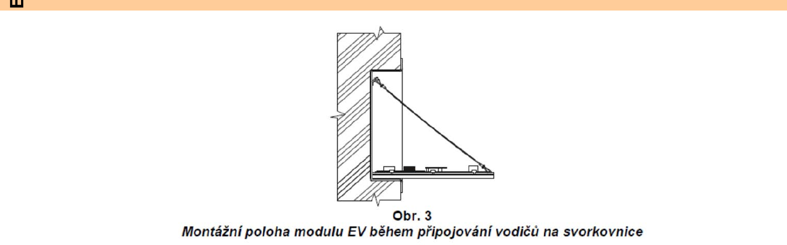
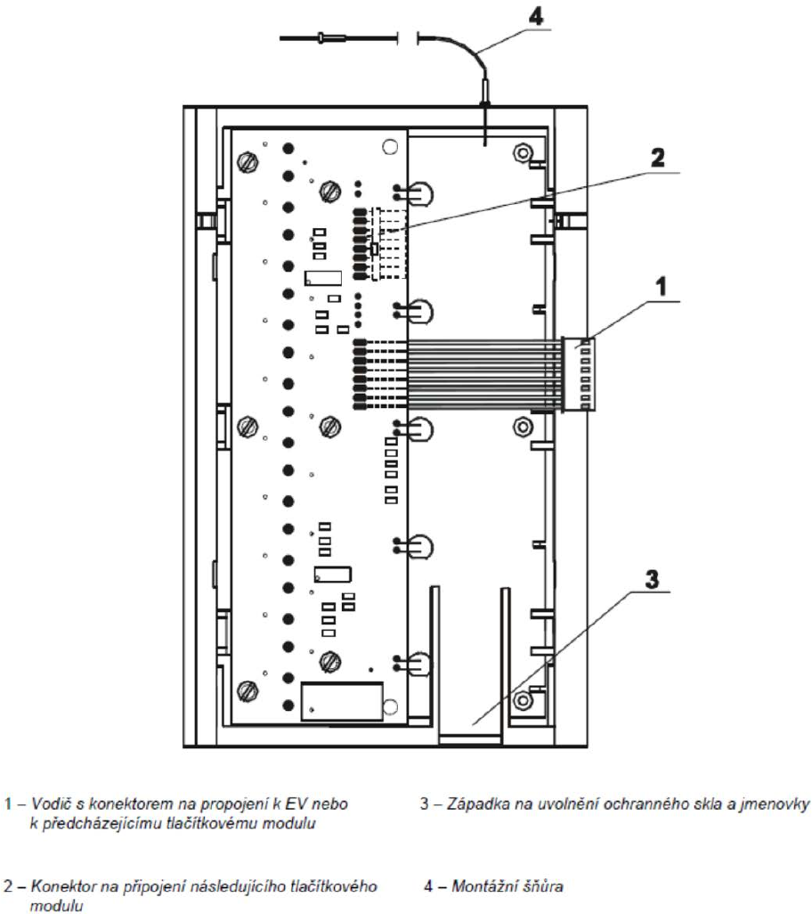

# Návod na fyzickou montáž a výměnu štítků – Tesla / GUARD prima

Tento dokument slouží jako praktický návod pro správce domu a techniky pro bezpečnou demontáž tabla, výměnu papírových jmenovek a zpětnou montáž modulů **Tesla / GUARD prima**.

---

## 🧰 Potřebné nářadí a pomůcky

1. **Klíč od zámku tabla (vložka FAB)** – pro odemčení koncové uzavírací lišty montážního rámu.
2. **Pomůcka pro vysunutí krycího skla / starého papírku**:
   * *Doporučeno:* Pinzeta s tenkými čelistmi, tenká plastová planžeta (karta), modelářský háček nebo opatrně zahnutá kancelářská sponka.
   * *Proč:* Papírové jmenovky i krycí plexisklo bývají po letech působení vlhkosti a prachu „přilepené“ a prsty je nelze spolehlivě vytáhnout bez pomůcky.
3. **Malý plochý šroubovák** (pro případné jemné nadzvednutí plastové západky).
4. **Nůžky nebo páková / kotoučová řezačka s pravítkem** (pro čisté nařezání vytištěných proužků).
5. **Měkký hadřík (mikrovlákno)** pro očištění prachu z vnitřní strany krycího plexiskla.

---

## ⚠️ Kritické bezpečnostní varování: Plochý sběrnicový kabel

> [!CAUTION]
> **Modul nikdy nenechávejte viset na propojovacím kabelu!**
> Jednotlivé moduly tlačítek jsou vzájemně propojeny plochým vícežilovým páskovým kabelem s konektory. Pokud modul vyjmete z rámu a necháte jej viset volně ve vzduchu, hmotnost modulu může snadno **vytrhnout vodiče ze svorkovnice, poškodit konektor nebo zlomit plošný spoj**.
> 
> Vždy použijte **montážní šňůru (č. 4)** umístěnou na zadní straně modulu a zavěste ji na pomocný úchyt v rámu (viz obrázek 2), případně kabel opatrně odpojte ze sousedních modulů.

---

## 🔧 Postup výměny krok za krokem

### Krok 1: Odemčení a sejmutí koncové zámkové lišty

Moduly jsou v montážním rámu uzamčeny krajní zámkovou lištou.

1. Zasuňte klíč do vložky FAB v koncové liště tabla a odemkněte zámek.
2. Vyjměte celou zámkovou lištu z montážního rámu a odložte ji na bezpečné místo.
3. Odstraněním lišty vznikne manipulační vůle pro posun jednotlivých modulů.

  

---

### Krok 2: Vyjmutí modulu z montážního rámu

1. Vyhledejte modul (sloupec tlačítek), ve kterém potřebujete vyměnit jmenovku (např. TT 10 s 10 tlačítky nebo TT 5).
2. Posuňte modul **směrem doprava** do uvolněného prostoru v rámu.
3. Opatrně modul vyklopte a vytáhněte směrem k sobě.
4. **Ihned zajistěte montážní šňůru (č. 4)** za háček/úchyt v montážním rámu, aby kabel zůstal zcela bez tahu.

  

---

### Krok 3: Uvolnění západky a výměna papírového štítku

Štítek se jmény je umístěn mezi hliníkovým čelním panelem a tělem modulu pod ochranným krycím sklem (plexisklem).

1. Na zadní straně modulu vyhledejte **západku (č. 3 na obrázku výše)**, která fixuje krycí sklo a papírový proužek.
2. Opatrně uvolněte západku (č. 3) mírným tlakem prstu nebo malým plochým šroubovákem.
3. **Vysunutí starého štítku:**
   * Pokud štítek nejde snadno vysunout prsty, zasuňte ze strany tenkou pinzetu nebo zahnutou kancelářskou sponku a jemně štítek zachyťte a vysuňte.
   * *Pozor:* Nikdy nepoužívejte hrubou sílu ani ostré čepele proti přední ploše plexiskla, abyste jej nepoškrábali.
4. Hadříkem z mikrovlákna očistěte vnitřní plochu skla od případného nánosu prachu.

---

### Krok 4: Vložení nového štítku

1. Vytištěný a nařezaný papírový proužek z aplikace zasuňte pod krycí sklo.
   * *Rozměr jednoho okénka štítku:* $48{,}6 \times 12{,}9\text{ mm}$.
   * *Výška celého 10štítkového proužku:* cca $189\text{ mm}$.
2. Z čelní strany vizuálně zkontrolujte:
   * zda jsou jména přesně vycentrována vůči okénkům,
   * zda je proužek orientován správným směrem (byt 10 nahoře, byt 01 dole pro 1. sloupec),
   * zda se papír v drážkách nevlní.
3. Zacvakněte plastovou **západku (č. 3)** zpět do zajištěné polohy.

---

### Krok 5: Zpětná montáž a uzamčení tabla

1. Opatrně odvěste montážní šňůru (č. 4).
2. Plochý sběrnicový kabel opatrně složte do prostoru za modulem (pozor na skřípnutí kabelu o ostré hrany montážního rámu).
3. Vložte modul zpět do vodicích drážek rámu a posuňte jej **doleva** do původní aretované pozice.
4. Zkontrolujte, zda všechny sousední moduly lícují.
5. Zasuňte zpět koncovou zámkovou lištu a zamkněte ji klíčem FAB.
6. **Funkční zkouška:** Postupně stiskněte všechna tlačítka daného sloupce, abyste ověřili, že se žádné tlačítko nezasekává a volně pruží zpět.
